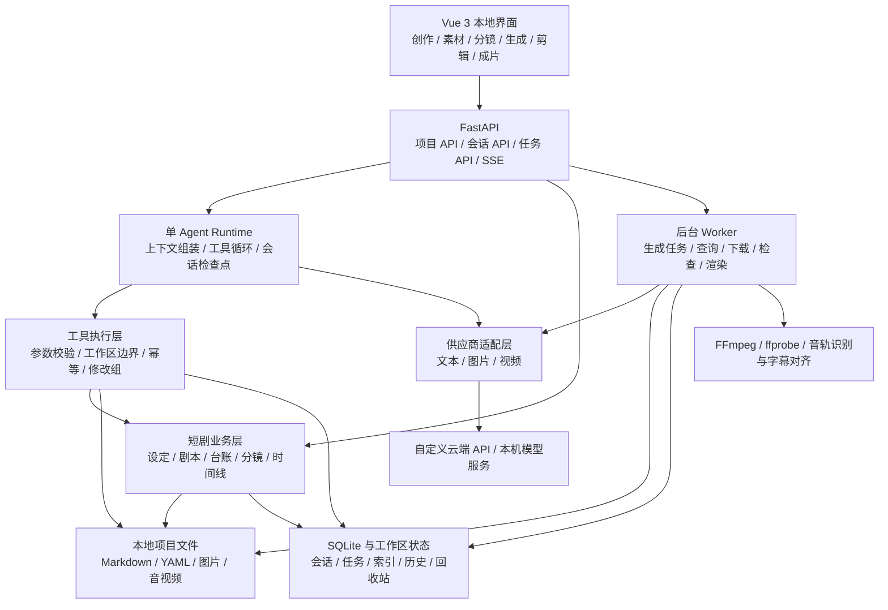
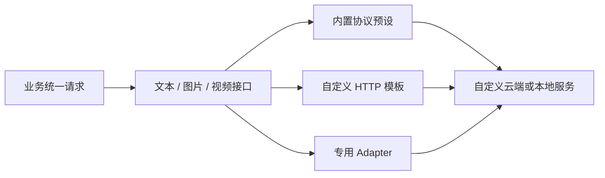
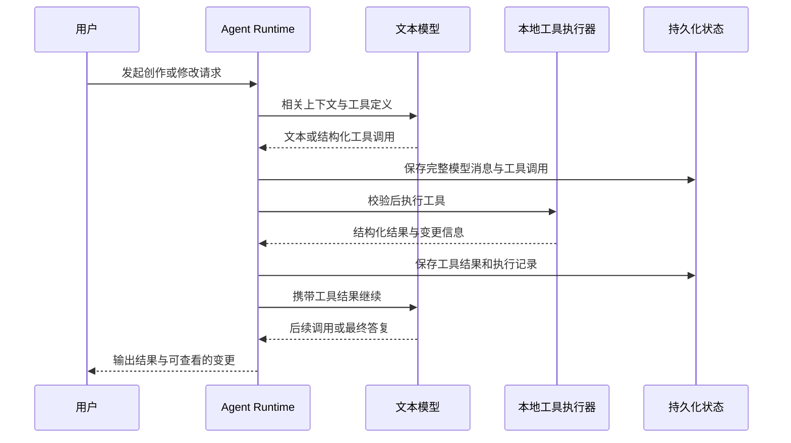

# MuWeave · 幕织

面向个人开发者、本地运行的 AI 短剧创作与制作平台。

从创意、世界观、人物、剧本，到分镜、参考图、原生有声视频、字幕、剪辑和成片导出，让模型通过受控工具参与整个制作流程。文本、图片、视频三类模型均支持自定义供应商。

> **项目状态：架构设计阶段。** 当前仓库用于记录已确认的完整架构与第一阶段范围，尚未实现应用功能。下文中的模块、目录、接口和工作流均为待实现方案，不代表目前已经可用。

开发优先级已明确为：**生成质量优先，同时保持工作流代码高效、稳定**。[质量优先的执行与验收设计](docs/superpowers/specs/2026-11-03-quality-first-design.md) 补充质量检查、性能策略与 Agent 框架选型建议；原架构正文保留，框架建议待兼容性验证后落实。

## 1. 项目定位

MuWeave 服务个人创作者和个人开发者：在自己的电脑上管理短剧项目，连接自己选择的云端 API 或本地模型，在可查看、可修改、可恢复的项目文件上工作，最终制作出可播放的视频。

核心原则：

- **本地优先**：项目文件和素材保存在本机，不依赖平台托管。
- **全流程闭环**：第一阶段就覆盖剧本写作到最终视频，内部按步骤实现，交付时走通整条链路。
- **模型可替换**：文本、图片、视频均支持自定义供应商和模型，云端与本地都能接入。
- **文件是创作主数据**：Markdown / YAML 可独立阅读、编辑、备份和迁移。
- **模型通过工具工作**：模型提出结构化操作，本地服务负责验证、执行和记录。
- **保持简单**：采用单体后端、单 Agent、SQLite 和一个后台 worker，第一阶段不引入复杂多 Agent、分布式队列、向量数据库或通用 DAG 引擎。

原有短剧资料项目仅作为流程与内容组织的参考，保持只读；MuWeave 在独立工作区开发。需要导入既有资料时，先复制到新工作区，再在副本上操作，不向参考目录写入日志、缓存或状态文件。

## 2. 第一阶段范围与验收

第一阶段目标是完成一集约 90 秒短剧的完整制作闭环，并支持修改剧本、单镜重做和重新导出。90 秒、70 集、5 卷等只是项目预设，不是平台硬编码限制。

| 环节 | 第一阶段范围 |
| --- | --- |
| 项目建立 | 创建本地项目、选择创作配置、管理项目文件 |
| 创作规划 | 选题、世界观、人物、总纲、卷纲、分集卡 |
| 剧本写作 | 单集写作、对话修改、连续性检查、密度检查、AI 审稿 |
| 制作拆解 | 分镜、镜头时长、对白、情绪、声音设计、生成提示词 |
| 参考素材 | 人物定妆、场景、道具参考图生成与本地图片上传 |
| 视频生成 | 原生有声视频生成、任务查询、素材下载、单镜多版本 |
| 素材确认 | 预览并选择 take，保留参考图与生成参数的关联 |
| 字幕与剪辑 | 按实际音轨对齐字幕、镜头排序、入出点、音量与可选背景音乐 |
| 成片导出 | FFmpeg 渲染 MP4，导出字幕与制作记录 |
| 修改与恢复 | 文件变更查看、撤销、回收站、任务续接、单镜重做和再次导出 |

完整流程：


### 验收标准

1. 能创建一个独立本地项目，从设定和分集卡写出一集剧本。
2. 能生成或上传人物、场景等参考图，形成可追溯的镜头素材关联。
3. 能通过自定义视频供应商生成带原生音频的镜头，查询任务并下载到本地。
4. 能在失败、刷新或应用重启后识别已有任务，避免直接重复提交付费生成。
5. 能预览、选择单镜版本，按实际素材建立时间线和字幕。
6. 能导出可播放的约 90 秒 MP4、字幕和制作记录。
7. 能修改剧本或单个镜头，识别需复核的素材，单镜重做后重新导出。
8. 文本云端兼容 API 与本机 Ollama 均可配置；工具调用须经过真实往返测试。
9. 三类模型都能配置自定义供应商，不把业务流程绑定到某一家服务。

## 3. 技术选型

| 层次 | 方案 | 职责 |
| --- | --- | --- |
| 前端 | Vue 3 + TypeScript + Vite | 本地创作与制作界面 |
| 状态管理 | Pinia | 项目、会话、任务和界面状态 |
| UI | Element Plus + 少量 Tailwind CSS | 表单、表格、弹窗和布局 |
| 文件编辑 | Monaco Editor | Markdown / YAML 编辑与选择内容 |
| 后端 | FastAPI + Pydantic | API、数据校验、工具执行和业务编排 |
| Agent | 自实现单 Agent 工具循环 | 上下文组装、模型调用、工具往返 |
| 业务数据 | Markdown / YAML | 设定、剧本、台账、分镜和时间线 |
| 应用状态 | SQLite | 会话、任务、配置、事件和素材索引 |
| 后台执行 | 一个后台 worker + 进程内异步队列 | 生成、下载、检查与渲染 |
| 实时更新 | Server-Sent Events（SSE） | 模型输出、工具和任务进度 |
| 媒体处理 | 本地 FFmpeg / ffprobe | 音视频探测、剪辑、字幕和渲染 |

采用单体结构。进程内队列只负责调度，SQLite 中的任务记录负责持久化；重启后从持久化记录恢复判断，不把内存队列当作可靠任务存储。

## 4. 总体架构



前端负责展示、编辑和用户选择；后端统一决定工具能否执行、修改能否提交、任务如何恢复。模型不直接获得本机文件系统或任意命令执行权限。

## 5. 模型与供应商：三类均支持自定义

| 类型 | 第一阶段接入范围 |
| --- | --- |
| 文本模型 | 自定义云端兼容 API + 本机 Ollama / 兼容本地服务，支持工具调用 |
| 图片模型 | 自定义供应商 / 本地服务，同时允许上传本地图片 |
| 视频模型 | 自定义供应商 / 本地服务，配置原生音频能力，支持任务查询和素材下载 |

供应商和模型分开配置。同一供应商可以有多个模型，同一制作项目可以为写作、图片、视频分别选择不同的连接。

### 5.1 供应商连接

保存供应商名称、服务地址 `base_url`、鉴权方式、密钥引用、自定义请求头等连接信息。密钥由本地后端通过系统凭据存储读写，不写进项目文件、模型上下文、前端日志或 Git 仓库。

### 5.2 模型配置

每个模型配置包含：

- 所属供应商、`model_id`、类型（文本 / 图片 / 视频）。
- 使用的协议适配器、默认生成参数。
- 能力声明，例如工具调用、流式输出、参考图、原生音频、同步或异步任务、远端取消。
- 供应商实际支持的尺寸、时长、比例等约束。

能力需要通过连接测试或实际请求验证。声明不支持工具调用的文本模型只能聊天，不让它假装执行工具；本地模型失败时不静默切换到云端服务。

### 5.3 适配方式



- **内置协议预设**：优先覆盖兼容文本接口、Ollama 及首批实际接通的图片和视频协议，填写地址、密钥、模型即可配置。
- **自定义 HTTP 模板**：支持请求路径、方法、参数模板、响应字段提取，以及视频任务状态映射。
- **专用 Adapter**：复杂签名、上传、轮询或非标准协议通过新增适配器实现。

“自定义供应商”不等于任意协议只换一个 URL 就能使用。连接配置与协议适配分开，业务层依赖统一接口，差异留在适配层。

文本适配负责统一消息、工具定义、流式增量和工具结果。图片适配负责生成请求与素材结果。视频适配负责提交、查询、下载，以及供应商确实支持时的取消。

### 5.4 连接测试

- 文本：基础对话测试，以及模型调用一个工具并接收工具结果的完整往返测试。
- 图片：真实生成图片并落盘检查。
- 视频：真实提交、查询、下载、探测媒体信息，核对原生音频能力。

预设用于降低配置成本，不限制用户只能使用预设供应商。

## 6. Agent 与工具调用

采用一个 Agent，通过提示配方和当前任务切换工作方式，不引入多 Agent 协作框架。



流式工具参数必须完整累积并通过结构校验后才执行。完整模型工具消息和工具结果持久化后，才推进下一轮调用。

### 6.1 文件与项目工具

| 工具 | 用途 |
| --- | --- |
| `list_files` | 列出工作区目录与文件 |
| `read_file` | 按需读取文件或指定范围 |
| `search_files` | 搜索设定、剧本与台账原文 |
| `create_directory` | 在允许的工作区内建立目录 |
| `write_file` | 创建或替换文件，记录变更前提 |
| `edit_file` | 按精确定位应用局部修改 |
| `apply_changes` | 提交关联文件的修改组 |
| `move_file` | 移动或重命名并记录历史 |
| `delete_file` | 软删除到工作区回收站 |
| `restore_file` | 恢复回收站中的文件 |
| `validate_project` | 执行结构、台账、连续性和密度校验 |
| `export_script_book` | 导出剧本集 |

图片、视频和成片操作通过受控业务工具提交持久化后台任务。长任务由 worker 查询和推进，模型无需反复调用工具轮询等待。

### 6.2 文件边界和写入规则

- 后端绑定当前项目工作区，统一处理路径规范化和越界检查，检查 Windows 联接与符号链接。
- 不向模型开放任意 shell、`eval` 或不受约束的文件系统访问。
- 修改携带原始文件哈希，以比较并交换（CAS）方式检查版本；文件已被外部修改时返回冲突，不覆盖未知改动。
- 局部编辑使用精确 patch，变更保留快照和 diff，支持查看与撤销。
- 删除采用回收站语义，保留恢复能力。
- 工具调用 ID 用于幂等，恢复会话时不盲目重复执行已完成操作。

### 6.3 多文件修改组

剧本、人物、规则、伏笔等关联修改作为一个修改组处理：

1. 将候选修改写入暂存区。
2. 检查文件版本、结构和关联约束。
3. 保存旧快照和提交日志。
4. 按修改组应用变更，记录每一步结果。
5. 发生中断时，根据日志恢复或执行补偿回滚。
6. 用户撤销时按组处理，并检查后续修改冲突。

普通文件系统上的多文件修改不具有天然原子事务。修改组通过暂存、日志、快照和恢复流程管理一致性，不把它描述为不可中断的数据库事务。

### 6.4 会话恢复

保存模型消息、工具调用 ID、完整参数、执行状态和结果。应用重启后，未结束会话标记为 `interrupted`。用户点击继续时，先核对不确定的写入或生成任务，再恢复后续步骤；不自动重放不确定操作。

## 7. 创作上下文与业务流程

### 7.1 按需组装上下文

按当前任务选取：

- 项目说明与世界观摘要。
- 总纲、当前卷纲和当前分集卡。
- 前集摘要及相关剧情进度。
- 与当前内容相关的人物、规则、伏笔与副本资料。
- 当前文件、用户选中的文本和近期对话。
- 通过文件搜索找到的相关原文。

不把全项目、全部 70 集一次性塞进模型。第一阶段使用文件检索、结构化索引和摘要，不依赖向量数据库。

### 7.2 创作配方

```text
选题
  → 世界观与人物
  → 总纲与卷纲
  → 分集卡
  → 单集剧本
  → 机械校验 + AI 审稿
  → 分镜与制作
  → 素材生成与剪辑
  → 导出
```

配方是轻量步骤和提示模板，不做复杂流程引擎。提供“通用短剧”和“规则闯关短剧”两套 profile；规则、副本等台账由 profile 决定是否启用。

G1–G5 作为阶段检查清单，记录问题和完成情况。`draft` 内容允许持续迭代；进入 `locked` 由用户显式操作，模型不能自行宣称锁定完成。

## 8. 素材、声音与视频生成

### 8.1 参考资产与版本

人物定妆、场景、道具和镜头素材都有稳定资产 ID。素材记录包含：

- 关联项目、人物、场景、镜头和参考资产 ID。
- 提示词、实际生成参数、供应商和模型。
- 供应商任务 ID、本地文件路径。
- 实际时长、尺寸、音轨信息等探测结果。
- 素材版本、候选 take、选用状态和依赖关系。

每个镜头可以保留多个生成版本，时间线引用已选用的具体资产版本。修改剧本或分镜后，关联素材标记为“需复核”，由用户决定是否重新生成，不自动触发新的付费任务。

### 8.2 原生音频优先，TTS 可选

视频生成优先使用供应商的原生音频能力，一次获得画面、对白和相关声音。独立 TTS 和 LipSync 是可选扩展，不作为第一阶段必经环节。

配音稿仍保留，用于表达台词、情绪、角色声音和镜头声音要求，也用于字幕和质量核对。以后需要固定音色、替换对白或补旁白时，再使用独立配音链路。

### 8.3 持久化任务

常规成功路径：

```text
queued → submitted → running → downloading → checking → ready
```

同时记录失败、取消请求和提交结果不确定等情况。不同供应商的状态映射成内部状态，保留原始状态便于诊断。

- 提交前记录任务和请求标识，提交后保存供应商任务 ID。
- 页面刷新后从本地记录继续观察，不重新发起生成。
- 应用重启后查询已有远端任务并续接下载、检查。
- 提交结果不确定时先核对供应商任务；供应商不支持可靠核对时，保留不确定状态并让用户决定，避免直接重复收费。
- 取消本地等待与取消远端生成分开处理；只有供应商支持时才尝试远端取消。
- 生成成功必须经过素材下载、落盘和媒体可用性检查，才能进入 `ready`。

后台队列处理等待和查询，任务进度通过 SSE 推送给界面。

## 9. 时间线、字幕与导出

第一阶段提供简单镜头列表与时间线：

- 镜头排序、入点与出点设置。
- 镜头多版本预览和选用切换。
- 音量调整、可选背景音乐。
- 字幕编辑、连续预览与导出。

目标镜头时长与实际生成时长分别保存。通过 ffprobe 读取真实媒体信息，根据素材和对白安排剪裁，不把 5 秒素材直接当作 6 秒完整镜头使用，也不为凑时长截断对白。

字幕按实际选用素材的音轨进行语音识别和对齐，再与剧本文字比对和人工修正。字幕不能只靠剧本均匀分配时间；重新选择 take 后，关联字幕标记为需复核。

字幕识别与对齐属于媒体处理能力，具体实现可替换；独立 TTS 的可选性不影响字幕流程。

导出使用本地 FFmpeg，结果包括 MP4、字幕文件和制作记录。记录选用素材版本、时间线及关键生成参数，使成片可追溯、可再次导出。第一阶段不实现完整专业非线性剪辑软件。

## 10. 数据归属与持久化

| 数据 | 主存储 | 说明 |
| --- | --- | --- |
| 世界观、人物、纲要、分集卡、剧本、台账 | Markdown / YAML | 唯一创作主数据，可脱离应用阅读和修改 |
| 分镜与时间线 | 项目内结构化文件 | 随项目备份与迁移 |
| 图片、音视频、字幕、导出结果 | 项目素材与导出目录 | 使用资产 ID 与业务记录关联 |
| 项目注册、供应商和模型配置 | SQLite | 本地应用配置，不保存密钥明文 |
| 会话、消息、工具执行、任务与事件 | SQLite | 运行状态和恢复依据，不是可随意丢弃的缓存 |
| 文件和素材索引 | SQLite | 可以从项目文件及素材元数据重建 |
| 暂存、历史快照、回收站 | 同盘工作区状态目录 | 支持修改组恢复、撤销与软删除 |
| API 密钥 | 系统凭据存储 | SQLite 只保存引用 |

SQLite 不成为剧本与设定的另一份可编辑主数据。索引可以重建，未完成任务和会话检查点必须妥善保存。

### 项目与本地状态目录示意

```text
data-root/
├─ projects/
│  └─ <project-id>/
│     ├─ series.yaml             # 项目信息、profile、可配置集数与时长
│     ├─ bible/                  # 世界观、人物、规则、副本、伏笔等
│     ├─ outline/                # 总纲、卷纲、分集卡
│     ├─ episodes/               # 单集剧本
│     ├─ production/             # 分镜、声音要求、生成计划和时间线
│     ├─ assets/                 # 参考图、镜头素材、素材元数据和字幕
│     └─ exports/                # MP4、字幕和制作记录
└─ .studio-state/
   └─ <project-id>/
      ├─ staging/                # 修改组暂存
      ├─ history/                # 快照、diff 与修改组记录
      └─ trash/                  # 可恢复的软删除

app-state/
└─ muweave.sqlite3               # 应用配置、会话、任务、事件和索引
```

这些是规划目录。工作区状态目录与对应项目放在同一磁盘；不在只读参考项目中创建状态目录。

## 11. 代码目录规划

```text
MuWeave/
├─ README.md
├─ frontend/
│  └─ src/
│     ├─ views/                  # 创作、素材、分镜、生成、剪辑、成片
│     ├─ components/             # 编辑器、文件树、对话、diff、素材预览
│     ├─ stores/                 # Pinia 状态
│     └─ api/                    # HTTP 与 SSE 客户端
├─ backend/
│  └─ app/
│     ├─ main.py                 # FastAPI 入口
│     ├─ api/                    # 项目、文件、会话、任务、素材等接口
│     ├─ agent/                  # Agent 循环、上下文、检查点
│     ├─ providers/              # 文本、图片、视频协议与自定义适配
│     ├─ tools/                  # 工具定义、校验、执行与幂等
│     ├─ workspace/              # 文件边界、修改组、历史、回收站
│     ├─ drama/                  # 创作数据、台账、校验、分镜和时间线
│     ├─ workflows/              # 创作配方、生成、下载与渲染编排
│     └─ db/                     # SQLite 模型、存储与状态恢复
├─ tests/                        # 文件边界、恢复、协议与业务验证
└─ scripts/                      # 本地开发与维护脚本
```

当前只初始化文档仓库，不提前创建这些尚未实现的应用目录，也不提供无法实际运行的启动命令。

## 12. 界面组织

| 视图 | 主要操作 |
| --- | --- |
| 创作 | 项目文件树、剧本编辑、AI 对话、检查结果、修改 diff |
| 素材 | 人物 / 场景 / 道具参考图、上传、版本和关联 |
| 分镜 | 镜头列表、对白、声音要求、参考资产和提示词 |
| 生成 | 供应商与模型选择、任务状态、下载、失败处理 |
| 剪辑 | take 选择、排序、入出点、字幕、音量和连续预览 |
| 成片 | 渲染进度、成片预览、MP4 / 字幕 / 制作记录导出 |

供应商设置统一管理连接、模型、能力和测试结果；用户在具体任务中选择使用哪一个配置。

## 13. 第一阶段实施顺序

第一阶段内部按三个步骤推进，最终验收范围仍是完整制作流程：

1. **创作闭环**：工作区、MD / YAML 编辑、文本云端与本地接入、工具循环、变更恢复、创作配方和校验。
2. **生成闭环**：自定义图片与视频供应商、参考素材、原生有声镜头、持久化任务、查询下载、素材检查和版本选择。
3. **出片闭环**：实际音轨字幕对齐、简单时间线、FFmpeg 渲染、成片导出、单镜重做与再次导出。

重点验证跨步骤的真实使用：工具调用能否执行并恢复，付费生成能否避免误重复，素材能否落盘播放，修改能否正确提示复核，最终视频能否完整导出。单纯“API 返回成功”或“页面能打开”不足以完成验收。

## 14. 参考资料

- [模型工具调用说明](https://developers.openai.com/api/docs/guides/function-calling)
- [Ollama 兼容接口](https://docs.ollama.com/api/openai-compatibility)
- [Ollama 工具调用](https://docs.ollama.com/capabilities/tool-calling)
- [Seedance 视频能力参考](https://seed.bytedance.com/en/seedance2_0)
- [视频生成任务 API 参考](https://docs.volcengine.com/docs/ark/create-video-generation-task-api?lang=zh)
- [FFmpeg 滤镜文档](https://www.ffmpeg.org/ffmpeg-filters.html)
- [ffprobe 文档](https://ffmpeg.org/ffprobe.html)

参考资料用于协议与流程设计；平台架构不绑定上述任一供应商。

## 15. 开源许可证

MuWeave 采用 [MIT License](LICENSE)。
