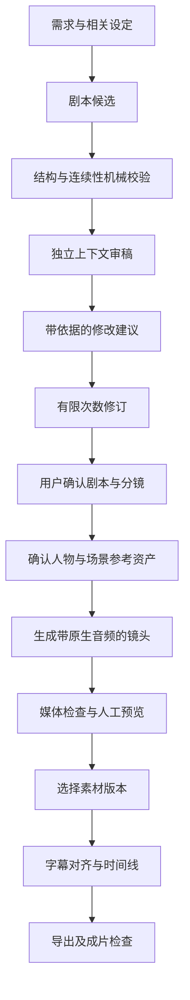

# MuWeave：质量优先的执行与验收设计

## 状态与约束

用户已明确：生成质量优先，同时工作流代码性能保持良好。本文细化 README 的完整短剧流程，不缩减第一阶段范围。本文记录设计，当前尚无应用实现或性能测试结果。

已有约束继续生效：Vue 3、FastAPI、SQLite、本地文件主数据、单主 Agent、自定义文本/图片/视频供应商、云端与本机模型、原生音频优先、TTS 可选、完整成片导出。原短剧资料项目保持只读。

下述框架和默认策略是实现建议；不能将它们视为已完成兼容性测试的结论。

## 目标

生成质量包含四个部分：剧本是否成立，角色与场景是否连续，画面与实际声音是否符合分镜，最终剪辑与字幕是否可用。技术成功与艺术质量分别记录。

代码性能目标是让界面操作保持响应、避免阻塞事件循环、对独立任务合理并发、避免无效模型请求和重复付费生成。不能通过静默切换较弱模型、丢弃相关设定、跳过校验或自动降低生成参数来提高速度。

第一阶段最终仍需完成一集约 90 秒短剧，并支持单镜重做和再次导出。

## 执行方案比较

| 方案 | 收益 | 代价 | 判断 |
| --- | --- | --- | --- |
| 完全自实现 Agent 循环 | 每个行为都能自行控制 | 自行维护流式协议、工具校验、供应商差异和异常处理 | 作为备选，不优先 |
| Pydantic AI + MuWeave 业务执行层 | 复用模型、工具与类型机制，业务独立 | 仍须自行实现文件一致性、任务恢复和兼容测试 | 推荐，待兼容性验证 |
| LangGraph 编排 | 明确的状态和检查点，适合复杂交接 | 引入额外流程抽象，需要控制与业务任务状态的重叠 | 保留为复杂编排的备选 |

框架选择不等于内容质量保证，也没有尚未测量的“最快”结论。先验证选定版本的文本适配、流式工具调用、取消、消息持久化与恢复能力，再锁定依赖。若验证不满足要求，应先记录失败用例，再调整适配器或比较备选方案。

## Agent 组织

第一阶段保留一个负责决策和工具调用的主 Agent，按当前任务加载写作、审稿、分镜等能力。单 Agent 可以多轮调用模型，也可以在不同任务中使用不同模型。

审稿可通过独立上下文的一次结构化模型调用进行：输入定稿候选、相关设定和检查标准，返回问题、依据和修改建议。它是一个明确的审稿步骤，不要求建立持续自治的审稿子 Agent。

模型配置支持按任务指定写作模型和审稿模型。默认使用用户选定的文本模型；只有用户配置后才使用不同模型。模型名称、供应商、参数、提示配方版本和输入版本随每次运行记录。

未来若实际评测证明独立子 Agent 有收益，可用于多集分析或专业审稿。其输出必须经过统一文件工具提交；不能并发直接覆盖同一文件。当前不建立多 Agent 协商系统。

## 质量流程

这是一组业务步骤，不要求把全流程改造成通用 DAG 引擎。

### 剧本与分镜

- 机械校验检查结构、引用、台账一致性和项目中有明确依据的约束。
- 模型审稿覆盖人物动机、剧情逻辑、情节推进、对白、信息密度与可拍摄性。
- 问题必须关联具体文件版本和位置，列出依据及严重程度；模型不确定的判断标记为待复核。
- 模型修订后重新执行相关检查，保留修改 diff。建议每次执行自动修订最多两轮，达到上限仍有问题时展示结果，不进入无限循环。
- 自动修订次数和模型调用预算可配置；上限只结束当前自动执行，不把未通过内容标记合格，也不阻止用户继续修改。
- 艺术质量由用户结合审稿建议决定；模型评分不能独自把内容变为 `locked`。

### 图片、人物与场景

- 先确认人物定妆与主要场景，再将已选参考资产关联到镜头。
- 保存参考资产的具体版本；提示词、人物身份、服装、场景和画幅保持可追溯。
- 图片和视频模型是否支持参考图、主体一致性或其他控制能力，由适配器能力声明与实际测试决定。
- 所选模型缺少当前任务要求的能力时，生成前展示缺项，要求用户改变配置或明确选择可执行的降级方案，不静默丢弃参考约束。

### 视频与原生音频

- 下载落盘、ffprobe 可探测、必要音视频轨存在、时长和尺寸符合任务约束，属于技术检查。
- 按业务需求检查对白缺失、明显截断、角色与场景不符等内容问题；自动识别不能确定时交给用户复核。
- 供应商任务完成仅表示远端完成；本地素材可用时进入 `ready`，该状态不表示艺术质量合格。
- 素材使用独立审阅状态：`unreviewed`、`accepted`、`rejected`、`needs_review`。只有选用且已接受、并与当前依赖版本一致的素材进入正式成片导出。
- 不因审阅失败自动重新提交付费生成。保留候选 take，用户决定重做哪些镜头。

### 字幕与成片

- 字幕基于选中素材的实际音轨识别与对齐，保留与剧本文字不一致处供修改。
- 时间线引用具体素材版本、入出点和字幕版本，按真实时长检查越界和对白截断风险。
- 修改剧本、参考资产、分镜或选用 take 后，依赖项标记 `needs_review`，不自动把旧审阅结论沿用到新版本。
- 导出前检查缺失/损坏素材、未接受或过期的选用素材、越界入出点和未复核字幕。草稿预览允许展示未确认内容并标明状态；正式成片导出要求上述检查通过。
- 渲染结果需要检查可探测性、必要音视频轨、预期时长和实际可播放性，并支持用户完整预览。

## 自定义供应商与能力

保留三类接口：文本交互、图片生成、视频提交/查询/下载。配置分为连接、模型、能力与协议适配器，供应商差异不进入短剧业务代码。

优先复用文本框架已有适配器，支持兼容接口与本地 Ollama；非标准文本协议通过自定义适配器实现。图片与视频保持独立适配，支持协议预设、HTTP 模板和专用适配器。

能连接不等于具备工具调用、参考图或原生音频等能力。建立按供应商、模型和版本记录的能力测试结果；未验证能力显示未验证，不自动宣称兼容所有模型。密钥不进入项目文件、模型上下文或运行日志。

## 工作流性能与可靠性

- 模型请求复用异步连接，使用超时和有上限的重试；流式工具参数完整校验后才执行。
- 上下文按相关人物、规则、前集摘要和当前文件组装；缓存以文件内容哈希及配置版本失效，不复用过期设定。
- 文件搜索、结构校验、生成查询、下载和渲染由程序执行，不让模型代替这些确定性操作反复思考。
- 后台采用持久化任务记录加有界调度，一个 worker 可并发等待独立网络任务。建议初始全局远端生成并发上限为 4、本地模型生成上限为 1，每个供应商默认上限为 1；实际有效并发取各限制的最小值，均可配置。
- FFmpeg 渲染初始并发上限为 1；视频处理通过受控子进程运行，使用固定参数构造，不向模型开放任意 shell。
- SQLite 使用 WAL、短事务和明确的写入串行化；文件扫描与阻塞媒体工作不占用 API 事件循环。
- SSE 事件具有持久化顺序号，支持断线续接；限制内存缓冲，不依赖无限队列维持连接。
- 对文件写入、生成提交和渲染分别记录执行状态；检查点不能代替副作用幂等。提交不确定时先核对，不直接重放付费请求。
- 单镜变更只使相关依赖失效；保持其他已确认镜头可复用。

## 验证与衡量

以下是待建立的验收方法，不是已达到的测试结论。

| 维度 | 验证方法 |
| --- | --- |
| 工具可靠性 | 实际工具往返、参数错误、Windows 路径边界、外部文件修改、幂等和崩溃恢复用例 |
| 模型兼容性 | 至少一条云端文本和一条本地文本链路；图片、原生有声视频真实提交和结果检查 |
| 剧本质量 | 固定样例与检查标准，保留人物/剧情冲突问题，人工比较修订前后，记录模型与参数 |
| 素材质量 | 同一分镜和参考资产下比较候选 take，人工审阅角色、画面、对白和声音 |
| 端到端质量 | 完整生成并导出一集约 90 秒视频，预览、单镜重做、字幕复核与再次导出 |
| 响应性能 | 记录机器、项目规模、并发与测试负载，测量本地交互 API 的 p50/p95、SSE 延迟和事件循环阻塞 |
| 执行效率 | 记录模型调用次数、Token、任务耗时、重试、失败原因与供应商报告的费用 |

性能基线应在真实机器和数据规模上测量后确定。缺少 API 密钥、本地模型或生成额度时，将真实供应商与成片验收明确列为未验证；模拟协议测试不能替代真实生成质量验收。

## 实施边界

保持 README 中创作、生成、出片三个内部步骤。首先落实工作区、模型适配、Agent 工具调用、版本化运行记录与恢复机制；随后连接素材质量审阅、生成任务和成片链路。

依赖版本、接口签名、数据库表和测试用例在实现计划中具体化；没有项目实测依据前，不预设某个模型或框架为永久最佳方案。模型与框架的升级必须保留现有验收样例并重跑兼容性和质量检查。

## 官方参考

- [Pydantic AI 模型与供应商](https://pydantic.dev/docs/ai/models/overview/)
- [Pydantic AI 函数工具](https://pydantic.dev/docs/ai/tools-toolsets/tools/)
- [LangGraph 概览](https://docs.langchain.com/oss/python/langgraph/overview)
- [单 Agent、Skills 与多 Agent 模式](https://docs.langchain.com/oss/python/langchain/multi-agent)
